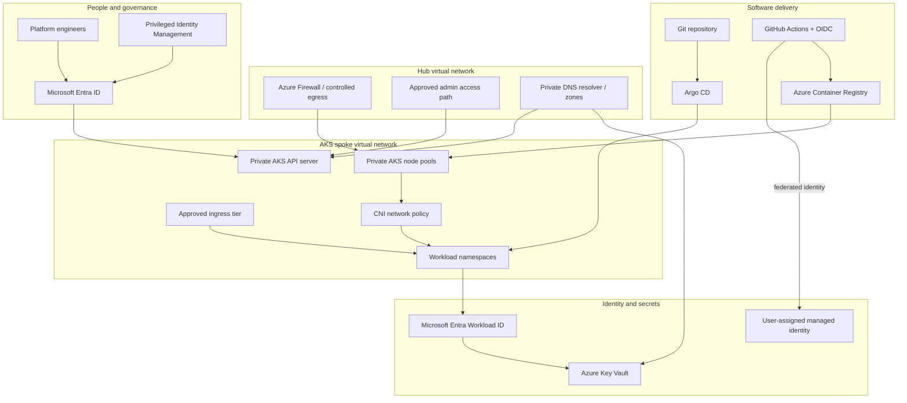

<div align="center">

# Azure AKS Zero-Trust Platform

### Private by design. Identity-first. Policy-enforced. Observable.

**An enterprise-style Azure Kubernetes Service reference architecture** focused on private cluster access, identity-based workload authentication, east-west isolation, governed delivery, and operational resilience.


[Architecture](architecture/README.md) · [Terraform](terraform/README.md) · [Security model](security/README.md) · [Operations](runbooks/README.md) · [Interview guide](interview-prep/README.md)

</div>

> **Implementation status:** This repository is a portfolio reference implementation and staged build plan. Terraform modules and sample manifests are starter code, not proof of a deployed or production-hardened AKS environment. Validate versions, provider arguments, policies, network paths, and Azure quota in a non-production subscription before deployment. No live Azure resources are created automatically.

## Executive summary

This project demonstrates an Azure-native Kubernetes platform around a zero-trust model:

- **Private control plane:** private AKS API endpoint and private DNS design.
- **Controlled network paths:** hub-spoke topology, firewall-mediated egress design, private endpoints and explicit DNS resolution.
- **Identity-first access:** Microsoft Entra integration, Kubernetes RBAC, managed identity and workload identity federation.
- **Secretless workloads:** Key Vault CSI integration pattern using workload identity.
- **Policy enforcement:** Azure Policy for AKS and Kyverno examples for admission-time controls.
- **GitOps delivery:** Argo CD application structure with environment separation and promotion controls.
- **Observability and resilience:** Azure Monitor/Container Insights integration points, Prometheus/Grafana blueprint, probes, autoscaling, backup and recovery considerations.

## Architecture overview



The drawing describes intended trust boundaries and data flows. It is not a deployment topology export. Choose a supported Azure CNI mode, ingress pattern, firewall routing design and DNS architecture together; these choices are interdependent.

## Repository map

| Path | Purpose |
|---|---|
| `architecture/` | Logical architecture, trust boundaries, traffic-flow notes |
| `terraform/` | Staged Azure infrastructure starter and design constraints |
| `kubernetes/` | Namespace, hardened workload, NetworkPolicy and policy examples |
| `gitops/` | Argo CD application starter and promotion model |
| `security/` | Zero-trust controls, threat model, hardening checklist |
| `pipelines/` | CI workflow examples and supply-chain gate design |
| `observability/` | Metrics, alerting and SLO starter examples |
| `runbooks/` | Deployment validation, incident and recovery procedures |
| `interview-prep/` | Senior-level design questions and answers |

## Suggested build sequence

1. **Design validation:** confirm regions, CIDRs, AKS networking mode, private DNS, egress and ingress design.
2. **Foundation:** deploy hub/spoke network, private DNS links, firewall routes and logging.
3. **AKS:** deploy a private cluster with Entra integration, managed identity, approved node pools and Azure Policy.
4. **Workload identity:** configure OIDC issuer, federated identity credential and Key Vault RBAC.
5. **Workload security:** apply namespace boundaries, Pod Security Admission labels, NetworkPolicies and Kyverno policies.
6. **Delivery:** configure GitHub OIDC, image scanning, registry permissions and Argo CD sync.
7. **Operations:** enable monitoring, alerts, backup, recovery tests, upgrades and cost controls.

## Security design principles

- No public AKS API endpoint in the target design.
- No long-lived cloud credentials in GitHub secrets or Kubernetes manifests.
- Least privilege for human, pipeline, cluster and workload identities.
- Default-deny workload ingress where practical, then add explicit service flows.
- Restrict outbound connectivity through documented destinations and approved egress.
- Scan and trace artifacts; pin external actions and container image digests for production.
- Separate platform, security and application ownership.
- Treat policy exceptions as time-bound, documented risk acceptances.

## Local validation

Run checks from the relevant folders:

```bash
terraform -chdir=terraform fmt -check -recursive
terraform -chdir=terraform init -backend=false
terraform -chdir=terraform validate
```

For Kubernetes manifests, use a current kubectl client and disposable cluster:

```bash
kubectl apply --dry-run=client -f kubernetes/
```

Client-side dry-run is only syntax/object validation. It does not prove policies are enforced, network paths work, Key Vault access succeeds, or the AKS API is reachable. Use server-side validation in a representative test cluster before production adoption.

## Important implementation notes

- The initial Terraform root provisions only a resource group, VNet and subnet; it does not create private AKS, hub networking, Azure Firewall, Private DNS, ACR, Key Vault or multi-region failover.
- Several components require subscription-level prerequisites, permissions, quotas, DNS ownership and regional availability.
- Firewall routing, private cluster DNS, private endpoints, ingress and CNI must be integrated and tested as one design.
- Kyverno policies and NetworkPolicies are examples. Verify compatibility and CNI enforcement on the selected AKS version and networking mode.
- Multi-region recovery is a documented target architecture, not implemented automated failover.

## Roadmap

- [ ] Validate Terraform against a pinned AzureRM provider release.
- [ ] Add a complete private AKS module and integration tests.
- [ ] Add hub-spoke routing, Azure Firewall and private DNS implementation.
- [ ] Add workload identity and Key Vault CSI end-to-end test.
- [ ] Add policy tests for Kyverno and Azure Policy.
- [ ] Add GitHub Actions OIDC deployment workflow with protected environments.
- [ ] Add Argo CD bootstrap and tested promotion workflow.
- [ ] Add live-cluster evidence, recovery exercise results and cost baseline.

## Author

**MD Amirul Haque** · Azure DevOps / DevSecOps / Platform Engineering

[GitHub](https://github.com/haqueamir70-coder) · [LinkedIn](https://www.linkedin.com/in/md-amirul-haque/)
