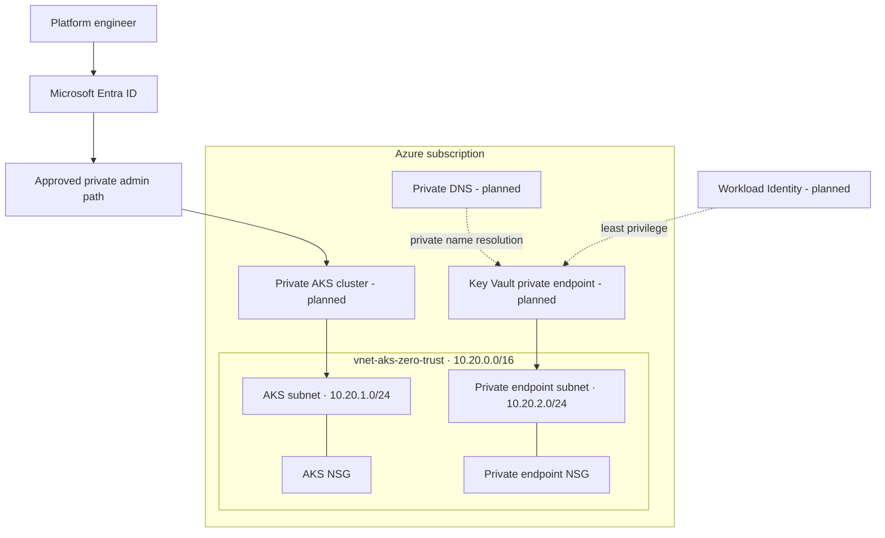

<div align="center">


### Private control plane · Identity-first workloads · Policy-enforced runtime

[](https://azure.microsoft.com/)
[](https://learn.microsoft.com/azure/aks/)
[](https://developer.hashicorp.com/terraform)
[](https://learn.microsoft.com/security/zero-trust/)

**An incremental Azure platform engineering project that builds a segmented network foundation for a future private AKS environment, then layers identity, workload security, GitOps and observability.**

[Deployment status](#-verified-deployment-status) · [Target architecture](#-target-architecture) · [Terraform workflow](#-terraform-workflow) · [Roadmap](#-implementation-roadmap)

</div>

> [!IMPORTANT]
> **Verified status recorded 30 October 2026:** the existing resource group, VNet, two subnets, two NSGs and subnet-to-NSG associations were deployed and verified. Private DNS, Private Endpoints, custom NSG rules and the AKS cluster were not yet deployed at that checkpoint. Do not interpret the target diagram as live infrastructure.

## Engineering objective

A zero-trust Kubernetes platform requires more than a private cluster switch. It needs a deliberately designed control-plane access path, network segmentation, workload identity, least-privilege RBAC, supply-chain controls, policy enforcement and operational visibility.

This repository builds the Azure foundation incrementally and records what is deployed separately from what remains planned.

## Verified deployment status

| Component | Resource / configuration | Recorded status |
|---|---|---|
| Resource group | `ravi` (pre-existing) | Existing |
| Virtual network | `vnet-aks-zero-trust` · `10.20.0.0/16` | Deployed |
| AKS subnet | `snet-aks` · `10.20.1.0/24` | Deployed |
| Private endpoint subnet | `snet-private-endpoints` · `10.20.2.0/24` | Deployed |
| AKS NSG | `nsg-aks-zero-trust` | Deployed and associated |
| Private endpoint NSG | `nsg-private-endpoints` | Deployed and associated |
| Custom NSG rules | — | Not yet configured |
| Private DNS / Private Endpoints | — | Planned |
| Private AKS cluster | — | Planned |

Re-run Azure CLI queries and Terraform state inspection before relying on this historical status for a new deployment.

## Target architecture



## Zero-trust control planes

| Plane | Intended control |
|---|---|
| Human access | Microsoft Entra ID, controlled admin path and Kubernetes RBAC |
| CI/CD identity | GitHub OIDC federation and short-lived Azure credentials |
| Cluster control plane | Private API endpoint and restricted administration |
| Workload identity | AKS Workload Identity; no static cloud credentials in pods |
| Secrets | Key Vault Private Endpoint, private DNS and scoped RBAC |
| Network | Explicit ingress/egress flows and Kubernetes NetworkPolicy |
| Supply chain | Image scanning, immutable digests and admission policy |
| Operations | Metrics, logs, alerts, upgrade and recovery runbooks |

## Terraform workflow

Run from the repository's `terraform/` directory. First verify the selected Azure subscription and the existing resource group.

```powershell
az account show
terraform fmt -recursive
terraform init
terraform validate
terraform plan -out=tfplan
terraform show -no-color tfplan
```

Apply only after reviewing the plan, subscription, address ranges, existing resources, permissions and expected cost:

```powershell
terraform apply tfplan
```

Never commit state, plan files, real variable files, credentials or private keys. Use a secured remote backend with locking for team use.

## Implementation roadmap

1. **Foundation — recorded complete:** VNet, AKS/private-endpoint subnets, NSGs and associations.
2. **Network policy — next:** map required node, control-plane, DNS, image-pull and egress flows before adding restrictive rules.
3. **Private connectivity:** create private DNS zones, links and Private Endpoint integrations; validate resolution from the intended clients.
4. **AKS:** provision private cluster, node pools, Entra integration and managed identity.
5. **Workload identity:** configure OIDC issuer, federated credentials and narrowly scoped Key Vault access.
6. **Runtime controls:** Pod Security Standards, NetworkPolicy, admission policy and image verification.
7. **Delivery:** GitHub Actions OIDC, ACR, GitOps and protected promotion.
8. **Operations:** Azure Monitor, Prometheus/Grafana, upgrade strategy, backup, recovery and cost governance.

## Operational guardrails

- Validate CIDR overlap with connected networks before provisioning.
- Do not create default-deny rules until required platform traffic is mapped and tested.
- Separate cluster administration from workload identity.
- Confirm private DNS from the actual operator and workload networks.
- Use a disposable environment for initial cluster policy testing.
- Capture real Terraform plans, Azure resource queries and CI runs as evidence.

## Repository documentation

- [Architecture and interview guide](docs/README.md)
- [Zero-to-hero walkthrough](docs/ZERO-TO-HERO.md)
- [Advanced interview bank](docs/ADVANCED-INTERVIEW-BANK.md)

## Maintainer

**MD Amirul Haque** · Azure · AKS · Terraform · DevSecOps

[GitHub](https://github.com/haqueamir70-coder) · [LinkedIn](https://www.linkedin.com/in/md-amirul-haque/)

<sub>Zero trust is an operating model: verify identity, constrain access and continuously validate.</sub>
