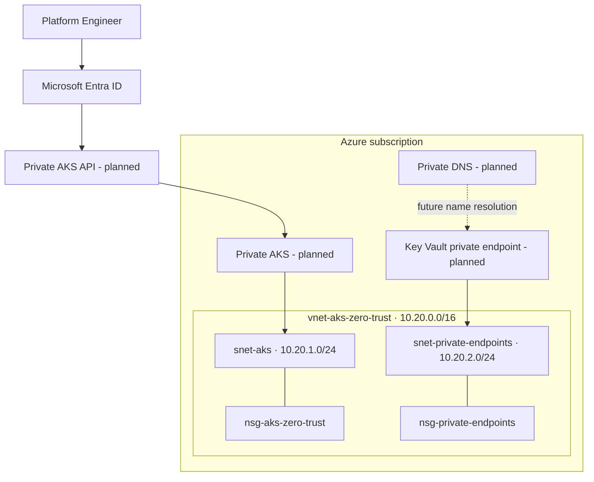

<div align="center">

# Azure AKS Zero-Trust Platform

### Private by design · Identity-first · Policy-enforced · Observable

**Hands-on Azure platform engineering project** built incrementally with Terraform, Azure networking, AKS, Microsoft Entra ID, Workload Identity, Key Vault, Kubernetes security and GitOps.


</div>

> **Build status (30 Oct 2026):** The Azure foundation is deployed and verified: existing resource group `ravi`, VNet `vnet-aks-zero-trust`, two subnets, two NSGs and both subnet-to-NSG associations. Private DNS, Private Endpoints and AKS are **not deployed yet**. This repository distinguishes deployed resources from planned architecture.

## What is deployed

| Component | Azure resource | Status |
|---|---|---|
| Resource group | `ravi` (pre-existing) | Existing |
| Virtual network | `vnet-aks-zero-trust` · `10.20.0.0/16` | Deployed |
| AKS subnet | `snet-aks` · `10.20.1.0/24` | Deployed |
| Private endpoint subnet | `snet-private-endpoints` · `10.20.2.0/24` | Deployed |
| AKS NSG | `nsg-aks-zero-trust` | Deployed + associated |
| Private endpoint NSG | `nsg-private-endpoints` | Deployed + associated |
| Custom NSG rules | None yet | Planned |
| Private DNS / Private Endpoint | — | Planned |
| Private AKS cluster | — | Planned |

## Target architecture

The target design will progressively add a private AKS API, controlled ingress/egress, private DNS, private service endpoints, Entra-based access, workload identity, Key Vault integration, policy enforcement, GitOps and monitoring. Architecture diagrams describe the **target state**, not current deployment evidence.



## Repository structure

- `terraform/` — deployed network foundation IaC and safe execution steps.
- `architecture/` — target topology, trust boundaries and network flows.
- `security/` — control catalogue and threat scenarios.
- `runbooks/` — deployment verification and operational procedures.
- `interview-prep/` — senior-level engineering interview material (being built).

## Build roadmap

1. **Foundation — complete:** VNet, subnets, NSGs and associations.
2. **Network security — in progress:** document required AKS flows; add explicit rules only after validating DNS, control-plane, node and egress requirements.
3. **Private connectivity:** private DNS zones, VNet links and private endpoint validation.
4. **AKS:** private cluster, managed identity, Entra integration and node pools.
5. **Workload security:** OIDC/Workload Identity, Key Vault CSI, Kubernetes RBAC and NetworkPolicies.
6. **Delivery:** GitHub Actions OIDC, image scanning, ACR and Argo CD.
7. **Operations:** Azure Monitor, alerting, upgrade strategy, backup, recovery and cost controls.

## Safe Terraform workflow

Run in `terraform/`:

```powershell
terraform fmt -recursive
terraform init
terraform validate
terraform plan -out=tfplan
terraform show -no-color tfplan
# Apply only after reviewing the plan:
terraform apply tfplan
```

Never commit state, plan files, real tfvars or credentials. Use a secured remote backend before team/production use.

## Engineering principles

- Least privilege for human, pipeline, cluster and workload identities.
- Private control-plane access and explicit network paths.
- No long-lived Azure credentials in GitHub Actions.
- Default-deny workload communication only after required flows are mapped and tested.
- Image scanning, immutable digests, admission controls and auditability.
- Evidence-based status: planned controls are never labelled deployed.

## Author

**MD Amirul Haque** · Azure DevOps / DevSecOps / Platform Engineering

[GitHub](https://github.com/haqueamir70-coder) · [LinkedIn](https://www.linkedin.com/in/md-amirul-haque/)
