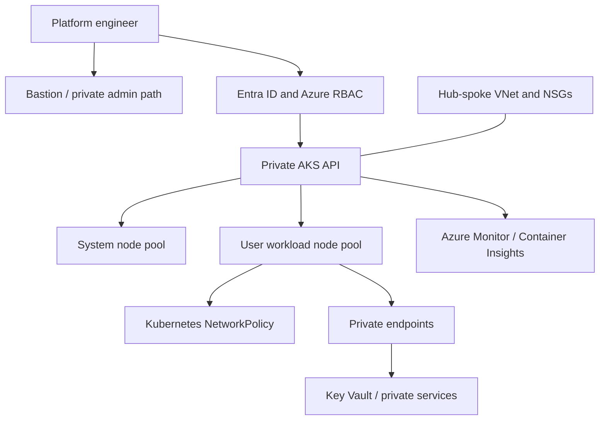

# Azure AKS zero-trust platform — Architecture & Interview Guide

Network foundation and intended private AKS security architecture. The diagram distinguishes the VNet/subnet foundation from private cluster, identity and workload controls that may still be planned.

## Architecture diagram

## Interview questions

1. 1. What does zero trust mean in an AKS environment?
2. 2. Why use a private AKS API server?
3. 3. How do Azure RBAC and Kubernetes RBAC interact?
4. 4. What is the role of managed identities and workload identity federation?
5. 5. How do you isolate system and user node pools?
6. 6. How do NetworkPolicy and NSGs differ?
7. 7. How do private DNS zones affect private AKS connectivity?
8. 8. How would you secure secrets using Key Vault CSI or workload identity?
9. 9. How do you monitor control-plane and workload health?
10. 10. What validation is required before calling a cluster zero-trust and production-ready?

## Interview preparation note
For every answer, explain the architecture, trust boundary, failure mode, telemetry, cost implication and validation evidence. Distinguish implemented, CI-validated, cloud-deployed and planned capabilities.

## Interview questions — suggested answers

### 1. Answer

Zero trust assumes no implicit trust based on network location. Authenticate and authorize every identity/request, minimize privileges and continuously verify context.

### 2. Answer

A private AKS API server is reachable only through approved private network paths, reducing public control-plane exposure. Admin access needs private connectivity and DNS.

### 3. Answer

Azure RBAC can authorize Azure resource operations and AKS-integrated Kubernetes permissions; Kubernetes RBAC controls API actions inside the cluster. Configure both deliberately.

### 4. Answer

Managed identities remove stored credentials for Azure resource access; workload identity federation maps Kubernetes service accounts to Entra identities for pod-level access.

### 5. Answer

System pools host critical cluster services; user pools host application workloads. Separate taints, labels, scaling, SKU and upgrade settings to isolate capacity and risk.

### 6. Answer

NSGs filter VNet/subnet/NIC traffic at the Azure network layer; NetworkPolicy controls pod-to-pod and pod ingress/egress inside the cluster.

### 7. Answer

Private DNS maps the private API hostname to private IPs and must be linked/resolvable from admin and connected networks. Incorrect DNS breaks kubectl access.

### 8. Answer

Use workload identity to obtain short-lived Entra tokens and Key Vault CSI/secret provider integration where appropriate. Restrict service-account and vault roles.

### 9. Answer

Monitor API/server health, node/pod readiness, resource saturation, control-plane diagnostics, audit events, network drops and application SLIs.

### 10. Answer

Prove private API reachability boundaries, identity/RBAC, policy enforcement, pod network isolation, secret access and monitoring in a real cluster. A VNet foundation alone is not a complete zero-trust AKS deployment.

## Complete zero-to-hero guide

See [ZERO-TO-HERO.md](./ZERO-TO-HERO.md) for the business scenario, architecture walkthrough, tool-by-tool explanations, implementation sequence, practical commands, troubleshooting playbook and additional scenario-based interview questions with answers.
