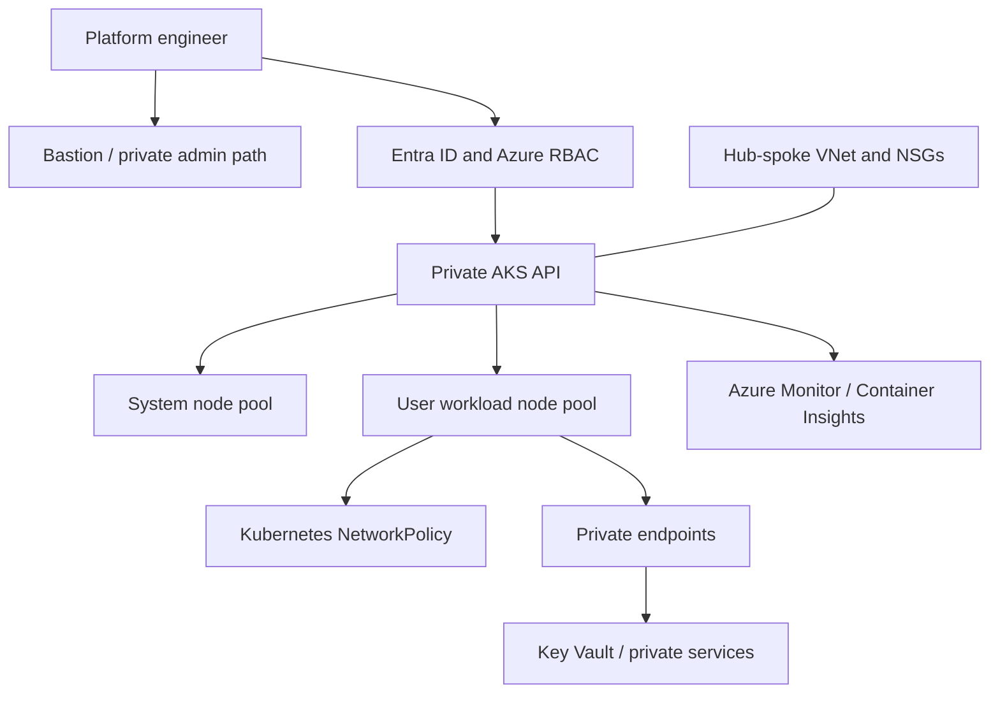

# Azure AKS zero-trust platform — Architecture & Interview Guide

Network foundation and intended private AKS security architecture. The diagram distinguishes the VNet/subnet foundation from private cluster, identity and workload controls that may still be planned.

## Architecture diagram

## Interview questions

1. 1. What does zero trust mean in an AKS environment?
2. 2. Why use a private AKS API server?
3. 3. How do Azure RBAC and Kubernetes RBAC interact?
4. 4. What is the role of managed identities and workload identity federation?
5. 5. How do you isolate system and user node pools?
6. 6. How do NetworkPolicy and NSGs differ?
7. 7. How do private DNS zones affect private AKS connectivity?
8. 8. How would you secure secrets using Key Vault CSI or workload identity?
9. 9. How do you monitor control-plane and workload health?
10. 10. What validation is required before calling a cluster zero-trust and production-ready?

## Interview preparation note
For every answer, explain the architecture, trust boundary, failure mode, telemetry, cost implication and validation evidence. Distinguish implemented, CI-validated, cloud-deployed and planned capabilities.
